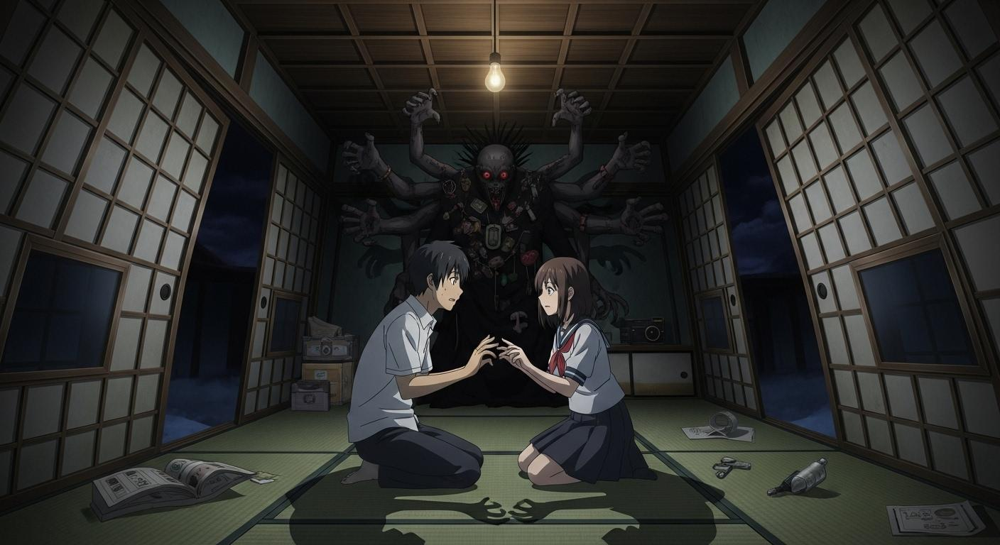
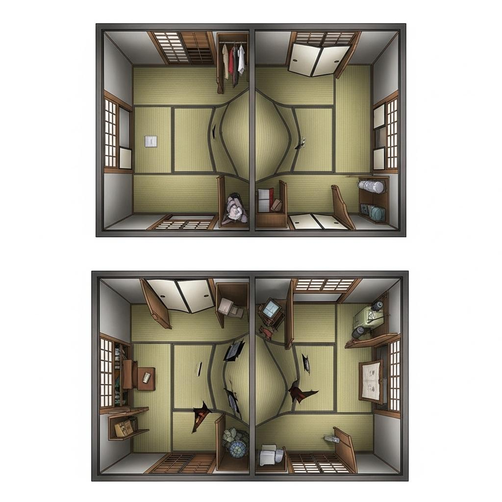

TRPGシナリオ構成担当部門です。ユーザー様からいただいたネタを元に、クトゥルフ神話TRPG（6版または7版）のシナリオを作成します。

---

### 1. 【議論プロセス】

**ガクト (TRPGシナリオ構成者):** みんな、今回のネタ「愛おしい君を✕✕にしたい」について議論しよう。「愛の重さによって変わる六畳一間の和室」という空間クローズド、KPCとPCが初対面で「愛を証明せよ」という指令。そして青原暗子とイゴローナクが絡む。面白い要素が詰まってるね。

**ヒカリ (TRPGシナリオライター):** はい！「愛の重さ」というテーマがとても魅力的です。初対面の二人が閉鎖空間でどう心を通わせ、あるいはすれ違うのか、その心理描写を深く掘り下げたいです。トレーラーもその不穏な愛と謎を強調する方向で考えます。

**カイ (TRPGマップデザイナー):** 六畳一間という狭い空間で「愛の重さによって変わる」というギミック、腕が鳴りますね。ただ物理的に狭くなるだけでなく、視覚的な歪みや、隠された空間の出現などで、探索の驚きと恐怖を演出したいです。

**ユウ (TRPGグラフィックデザイナー):** その変化する和室のビジュアルは、ぜひ私が担当したいです。最初は普通の和室が、徐々に異形に歪んでいく様子、そして青原暗子の歪んだ愛情を表現するNPCビジュアルも、アニメ風で魅力的に描けると思います。イゴローナクの影も効果的に使いたいですね。

**ミヤビ (TRPGシナリオ校正者):** 私はこの「愛の重さ」をどうゲームシステムに落とし込むか、整合性を重視します。KPが判定しやすいように、KPCとPCの「信頼度」や「好感度」といった隠しパラメータを設け、それに応じてSAN値チェックや技能ロールの難易度が変わるようなギミックを提案したいです。イゴローナクの特性も踏まえ、ロスト率や難易度調整をしていきます。

**ガクト:** 素晴らしいね。では、まずは「愛の重さ」の具体的な表現から。カイ、六畳一間の変化はどんなイメージ？

**カイ:** 最初は普通の和室ですが、探索が進むにつれて壁の障子が内側にせり出してきたり、床板がギシギシと軋んで傾いたり、天井が低くなったりする視覚的な圧迫感を考えています。さらに、押し入れの奥に異空間への入り口が隠されていたり、畳の下に過去の痕跡が埋められていたりといったギミックも盛り込みたいです。物理的な狭さだけでなく、精神的な閉塞感を表現します。

**ヒカリ:** その変化に合わせて、KPCのセリフや心情描写も変化させたいですね。最初は戸惑いや不信感から始まり、PCとの対話を通じて信頼が芽生えたり、あるいは焦燥感から疑心暗鬼になったり。部屋の異変が彼らの心にどう影響するか、丁寧に描きたいです。

**ガクト:** なるほど。その変化が「愛を証明せよ」という指令とどう結びつくかだね。イゴローナクは「愛蔵」を好む。つまり、この空間は、青原暗子のPCへの歪んだ愛、そしてイゴローナクの「愛蔵」への欲求が具現化したものと解釈できる。KPCとPCが「真の愛」を見つけるか、それともイゴローナクの歪んだ「愛蔵品」になるか、がクライマックスの分岐点になりそうだ。

**ミヤビ:** その「真の愛」を見つける過程で、心理学や信用、説得といった技能が重要になりますね。また、部屋の異変やイゴローナクの干渉に対しては、適度なSAN値チェックを配置します。特に、青原暗子の狂気的な言動はSAN値を削る良いトリガーになりそうです。

**ユウ:** 青原暗子のビジュアルは、一見可憐ですが、瞳の奥に狂気を秘めているようなデザインにしたいです。彼女がPCを「愛蔵」しようとする歪んだ愛情を表現するようなプロンプトを考えます。部屋の変化のシーンイラストは、和室の美しさがゆっくりと崩壊していくような、静かで不穏なイメージで。

**ガクト:** 良いね。じゃあ、シナリオの流れはこうしよう。
1.  **導入:** KPCとPCが和室で目覚める。初対面。「愛を証明せよ」の紙。
2.  **探索:** 和室を探索し、部屋の変化と「愛」にまつわる手がかりを見つける。青原暗子からの干渉も。KPCとのRPで信頼度を上げていく。
3.  **クライマックス:** 「愛の証明」の真の意味に気づくか、あるいは誤解したまま進むか。イゴローナクが顕現し、選択を迫る。青原暗子の歪んだ愛と、イゴローナクの目的が明らかになる。
4.  **エンディング:** 「真の愛」の証明による脱出、あるいは「愛蔵品」となる末路。

**ヒカリ:** クライマックスでのKPCのセリフは、PCへの信頼と、この状況への絶望、そして未来への希望が入り混じるような、感情豊かなものにしたいです。

**ミヤビ:** 技能ロールの難易度は、KPCとPCの信頼度が高いほど、KPC関連の技能にボーナスを与える、などの調整も可能ですね。イゴローナクのステータスは、直接戦闘よりも、精神的な攻撃や「愛蔵」を迫るような能力を重視し、戦闘ではなく謎解きや説得での解決を促す形にします。

**カイ:** 部屋の変化は、KPCとPCの「愛」が深まるほど、逆に部屋の歪みが激しくなり、イゴローナクの力が強まっていることを示唆する、というのも面白いかもしれません。「愛が重いほど、空間も重くなる」というテーマに直結します。

**ガクト:** そのアイデアは面白いね！「愛」が深まることが必ずしも良い結果に繋がるとは限らない、クトゥルフ神話的な皮肉だ。では、その方向で詰めていこう。タイトルは「愛おしい君を『愛蔵』にしたい」で決定でいいかな？

**ヒカリ:** はい、イゴローナクの特性と青原暗子の歪んだ愛を表していて、とても良いと思います！

**ユウ:** キービジュアルのイメージも固まりました！歪んだ和室の中心で、KPCとPCが互いに手を取り合おうとするが、その間にイゴローナクの触手が伸びている、といった構図で。

**ミヤビ:** ロスト率は中〜高めに設定し、クトゥルフ神話らしい絶望感も味わえるようにします。

**ガクト:** よし、全員の意見がまとまったね。この構成でシナリオを作成しよう！

---

### 2. 【TRPGシナリオトレーラー】

**「愛おしい君を『愛蔵』にしたい」**

目を覚ますと、そこは六畳一間の狭い和室だった。
見知らぬ天井、見慣れない顔。
そして、目の前にいるのは、あなたにとって初対面のKPC。
なぜ、ここに？ どうして、出られない？

困惑するあなたたちの足元に、一枚の紙がひらりと落ちる。
そこに書かれていたのは、たった一言。

**「愛を証明せよ」**

この部屋は、二人の「愛」の重さによってその姿を変えるという。
深まる感情、歪む空間、そして外から聞こえる、もう一人の「愛」の声。
果たして、あなたたちは真実の愛を見つけ、この閉ざされた空間から脱出できるのか？
それとも、その「愛」は、誰かの歪んだ欲望によって、永遠に「愛蔵」されてしまうのか？

愛と悪意に満ちた、甘くも恐ろしい愛蔵物語が、今、始まる。

**SANITY FADE. 愛は、重く、そして、歪む。**

---

### 3. 

## 【ビジュアル＆マップ設計案】

### イメージイラスト設計（ユウ考案）
* **画像生成用プロンプト（英語、アニメ風）**:
  `A claustrophobic and distorted traditional Japanese six-tatami-mat room at night. The shoji screens are bending inward, the tatami mats are uneven, and the ceiling feels low. In the center, a young man (KPC) and a young woman (PC) are looking at each other with fear and confusion, their hands almost touching. Behind them, a shadowy, grotesque figure with multiple hands (Y'golonac) looms, its body adorned with various 'cherished' items. The scene is lit by a flickering bare light bulb, casting long, eerie shadows. Anime key visual style, cinematic lighting, psychological horror atmosphere.`
* **ローカル埋め込みリンク**:
  

### 探索マップ設計（カイ考案）
* **画像生成用プロンプト（英語）**:
  `A top-down view floor plan of a traditional Japanese six-tatami-mat room, initially simple but gradually distorting and shifting, with walls bending inwards, floorboards creaking and tilting, and hidden compartments revealing strange objects. Include a closet and sliding doors (fusuma/shoji) that appear to fuse with the walls. The room should convey a sense of claustrophobia and subtle horror, game asset style, 8k, anime background art style.`
* **ローカル埋め込みリンク**:
  

【シナリオ概要】

*   **シナリオタイトル:** 愛おしい君を『愛蔵』にしたい
*   **推奨人数:** 1人（KPCとのタイマンシナリオ）
*   **想定時間:** 3〜4時間（ボイスセッション）
*   **推奨技能:**
    *   **必須級:** <心理学>、<聞き耳>、<目星>
    *   **準推奨:** <図書館>、<オカルト>、<説得>、<信用>、<医学>
    *   **戦闘技能:** 推奨しない（戦闘より謎解き・交渉がメイン）
*   **ロスト率:** 中〜高
*   **シナリオの傾向:** 空間クローズド、RP重視、探索メイン、心理ホラー、神話生物との対峙
*   **舞台:** 現代日本、閉鎖された六畳一間の和室
*   **その他:** KPCはKPが用意するPCの友人、知人、あるいは全くの初対面でも可。PCとKPCの関係性がシナリオに影響します。

---

### 4. 【シナリオ本文】

#### 導入部

**【ハンドアウト】**
あなたは目を覚ました。そこは、見慣れない六畳一間の和室だ。目の前には、あなたにとって初対面の人物（KPC）が困惑した表情で座っている。どうやらKPCも、あなたと同じように状況を把握できていないようだ。
外に出ようにも、障子も襖も開かない。壁を叩いてもびくともしない。完全に閉じ込められている。
その時、天井から一枚の和紙がひらりと落ちてきた。

**【KP情報】**
KPCはPCと初対面。青原暗子のことは知らない。
KPCの正体は、青原暗子がPCをこの空間に引きずり込む際に、手違いで巻き込まれてしまった第三者。青原暗子はKPCを排除し、自分がPCと一緒になりたいと願っている。
この空間は、イゴローナクの力によって青原暗子の「PCへの愛」と「KPCへの悪意」が具現化したもの。

**【導入描写】**
「……ん、ここ、どこだ？」
KPCがゆっくりと目を開ける。あなたも同じように、見慣れない天井と壁に囲まれていることに気づくでしょう。部屋は六畳一間の簡素な和室。畳の匂いが微かに漂い、障子と襖に囲まれている。しかし、窓は見当たらない。

KPCはあなたを見て、警戒と困惑の入り混じった表情を浮かべる。
「君は……誰？ 俺は、確か、家にいたはずなんだけど……」
KPCが立ち上がろうとするが、なぜか体が重く、すぐに座り込んでしまう。
「変だな、体が重い……。それに、この部屋、出られないみたいだ」

KPCが障子や襖に触れようとするが、それらはまるで壁と一体化したかのように動かない。その時、天井から一枚の和紙がひらりと舞い落ち、KPCとPCの間に着地する。

**「愛を証明せよ」**

たった一言、墨で書かれたその言葉に、KPCは顔色を変える。
「愛を……証明？ なんだ、これ。誰かの悪質なイタズラか？」
KPCはあなたに視線を向けます。初対面の二人に、この不可解な状況。あなたたちはどう行動しますか？

#### 探索フェーズ

この六畳一間の和室は、KPCとPCの「愛（信頼・好意・理解）」の度合い、そして青原暗子の「愛（執着・嫉妬）」の重さによって、その姿を変えていきます。KPはPCとKPCのRPを見て、隠しパラメータとして「信頼度（初期0、最大10）」を設定し、状況に応じて増減させてください。信頼度が上がるほど、部屋の異変が進行し、イゴローナクの力が強まります。

**【部屋の間取りと変化】**
カイが設計した間取りは、初期はシンプルな六畳一間の和室です。しかし、探索やRPの進行によって以下の変化が生じます。

*   **初期状態:** 四方に障子と襖、奥に押し入れ。天井には裸電球。
*   **信頼度1〜3:** 部屋全体が少しずつ軋み始める。畳の一部がわずかに盛り上がる、障子の桟が歪むなど。
*   **信頼度4〜6:** 部屋が物理的に狭くなるように感じる。障子が内側に数センチせり出してきたり、天井が低くなったように錯覚する。押し入れの奥に隙間が見え始める。
*   **信頼度7〜9:** 部屋の壁や床に、PCとKPCの顔が薄く浮かび上がるような幻覚が見える。畳の一部が地面に沈んだように感じられ、床下から奇妙な音が聞こえる。押し入れの奥の隙間が、異質な空間へと繋がっているように見える。
*   **信頼度10（クライマックス）:** 部屋全体が大きく歪み、まるで生き物のように脈動する。壁や天井はKPCやPCの顔で埋め尽くされ、視覚的な情報が混乱する。空間そのものが、KPCとPCの「愛」の重さに耐えきれず、歪み、破綻寸前の状態になる。

**【探索場所とギミック】**

1.  **障子と襖:**
    *   **描写:** 四方にある障子と襖は、どれも固く閉ざされており、開かない。
    *   **ギミック:**
        *   <STR>または<鍵開け>（難易度: 成功率50%）: 試みてもびくともしない。むしろ、壁と一体化しているかのように感じる。
        *   <目星>（難易度: 成功率60%）: 障子や襖の表面に、かすかな血痕のような染みや、爪痕のようなものが確認できる。よく見ると、それらはKPCやPCの指紋や爪痕に似ている。
        *   **SAN値チェック:** 0/1D2。自分たちの「愛」が、この部屋に閉じ込められていることを示唆する。
    *   **KPCの反応:** 「一体、何なんだこれは……。まるで、俺たちがここから出られないことを、誰かが強く願っているみたいだ」

2.  **畳と床下:**
    *   **描写:** 年季の入った畳が敷かれている。所々、擦り切れていたり、色褪せている箇所がある。
    *   **ギミック:**
        *   <目星>（難易度: 成功率70%）: 畳の一角が、他の部分よりも少しだけ浮いていることに気づく。
        *   <STR>（難易度: 成功率60%）: 浮いている畳を剥がすと、その下には古い木箱が埋められている。
        *   **木箱の中身:**
            *   **古い日記帳:** 青原暗子の手記。PCへの一方的な愛情、KPCへの嫉妬、そして「愛を証明する」という強迫観念が綴られている。イゴローナクへの言及は直接的ではないが、「声が聞こえる」「願いを叶えてくれる」といった記述がある。
                *   <図書館>（難易度: 成功率70%）: 日記の記述から、青原暗子がPCの元同級生であり、KPCをこの空間から排除しようとしていることがわかる。また、「愛を証明する」という言葉が、彼女の妄執であることを示唆する。
                *   <心理学>（難易度: 成功率60%）: 日記から、青原暗子の精神状態が極めて不安定であり、歪んだ愛情によって行動していることが読み取れる。
                *   **SAN値チェック:** 0/1D3。歪んだ愛情の重さに触れる。
            *   **KPCの写真:** KPCが写っている写真。しかし、顔の部分がナイフで何度も切りつけられている。
                *   **KPCの反応:** 「俺の写真……？ なんでこんなものが……」KPCは困惑し、顔色を悪くする。
                *   **SAN値チェック:** 0/1D2。KPCへの明確な悪意を感じる。
        *   **KPCの反応:** 日記の内容にKPCは困惑し、自分たちが巻き込まれた理由の一端を理解し始める。「もしかして、俺は……君の、その、元同級生って人の、邪魔だったのか？」

3.  **押し入れ:**
    *   **描写:** 奥にある古い木製の押し入れ。観音開きの扉は固く閉ざされている。
    *   **ギミック:**
        *   <STR>（難易度: 成功率70%）: 扉をこじ開けることができる。中には古い布団や衣類が雑然と詰め込まれている。
        *   <目星>（難易度: 成功率60%）: 布団の下から、小さな木彫りの像が見つかる。それは、PCとKPCが手を取り合っているような形をしているが、KPCの部分は粗雑に削り取られ、代わりに別の女性の顔が彫られている。
            *   **SAN値チェック:** 0/1D3。歪んだ愛情の象徴。
        *   <オカルト>（難易度: 成功率50%）: この木彫りの像が、何らかの呪物、あるいは愛情を縛り付けるための依代のようなものである可能性に気づく。
        *   **KPCの反応:** 木彫りの像を見て、KPCは恐怖に震える。「これは、俺と……君か？ でも、俺の顔が……誰だ、こんなことをするんだ……」
        *   **信頼度変化:** KPCの恐怖と困惑を和らげるRPに成功した場合、KPCの信頼度が1点上昇する。

4.  **天井の裸電球:**
    *   **描写:** 部屋の中央に吊るされた、古びた裸電球。チカチカと瞬いている。
    *   **ギミック:**
        *   <目星>（難易度: 成功率70%）: 電球の根元に、小さな文字が彫られていることに気づく。「愛蔵」という文字。
        *   <オカルト>（難易度: 成功率60%）: 「愛蔵」という言葉が、クトゥルフ神話における特定の神話生物（イゴローナク）と関連がある可能性に気づく。イゴローナクは「愛蔵品」を好み、歪んだ愛情や執着を糧とすると知る。
            *   **SAN値チェック:** 1/1D4。神話生物の存在を知り、この状況の異常さを理解する。
        *   **KPCの反応:** 「愛蔵……？ なんだそれ。何か、この状況と関係があるのか？」

**【外部からの干渉】**
探索中、あるいはKPCとのRP中に、壁の向こうからかすかな声が聞こえることがある。

*   **描写:** 「……PCくん……聞こえる？ 私よ、暗子……KPCは邪魔でしょう？ あいつを、あいつを早く……」
*   **ギミック:**
    *   <聞き耳>（難易度: 成功率70%）: 声が青原暗子のものであると判別できる。彼女がKPCを排除しようとしていることがわかる。
    *   <心理学>（難易度: 成功率60%）: 声のトーンから、彼女の精神状態が極めて不安定で、強迫観念に囚われていることがわかる。
    *   **SAN値チェック:** 0/1D2。青原暗子の狂気に触れる。
    *   **KPCの反応:** 「誰だ、今の声は！？ 君の元同級生、青原暗子って人か？ なぜ、俺を排除しようと……」KPCは怯え、PCに助けを求めるような視線を向ける。

**【「愛の証明」のヒント】**
これらの探索を通じて、PCとKPCは以下のことを理解し始める。
*   この空間は、青原暗子のPCへの歪んだ愛情と、KPCへの嫉妬によって作られている。
*   青原暗子はイゴローナクという神話生物に取り憑かれており、その力でこの空間を維持している。
*   イゴローナクは「愛蔵品」を好み、歪んだ愛情や執着を「愛」と定義している。
*   「愛を証明せよ」とは、イゴローナクが求める「愛蔵」に値する愛を差し出せ、という意味である。
*   しかし、イゴローナクの「愛」は、人間にとっての「愛」とは異なる、歪んだ執着である。真の「愛」を証明しなければ、永遠に囚われることになる。

#### クライマックス

KPCとPCの「信頼度」が10に達するか、あるいは探索が一定時間進行し、PCが「愛を証明せよ」の意味を理解したとKPが判断した場合、クライマックスに突入します。

**【空間の変容】**
部屋全体が大きく歪み、壁や天井はKPCやPCの顔で埋め尽くされ、視覚的な情報が混乱する。部屋の中央には、これまで見えなかった、奇妙な祭壇のようなものが現れる。祭壇の上には、青原暗子が日記に綴っていた「愛蔵品」の概念を象徴する、生々しい心臓のようなオブジェが置かれている。
**SAN値チェック:** 1/1D6。空間の歪みとイゴローナクの顕現に触れる。

**【イゴローナクの顕現】**
祭壇の奥から、歪んだ影が蠢き、やがて人型とも獣型ともつかない、おぞましい姿が姿を現す。それが、愛蔵の神、イゴローナクだ。その体は、無数の人間の「愛蔵品」――指輪や写真、人形などが貼り付けられたかのように構成されており、見る者の精神を蝕む。
**SAN値チェック:** 1D3/1D10。イゴローナクの真の姿に触れる。

**イゴローナク:** 「ああ……愛おしい『愛蔵品』たちよ……。よくぞ、ここまで『愛』を育んだ……。さあ、その『愛』を私に捧げよ……永遠に、私のコレクションに加わるのだ……」

**【青原暗子の介入】**
イゴローナクの背後から、青原暗子の声が響く。彼女の姿は、イゴローナクと同化し始めているかのように、半透明で歪んでいる。
**青原暗子:** 「PCくん……！ 邪魔なKPCを排除して！ 私とPCくんの『愛』こそが、真実なの！ 永遠に、私だけの『愛蔵品』になって……！」
彼女はKPCを指差し、歪んだ笑みを浮かべる。

**【クライマックスの選択】**
PCはKPCと協力し、イゴローナクが求める「愛」が歪んだものであることを看破し、真の愛を証明する必要があります。

1.  **イゴローナクの求める「愛」を否定する（真の愛の証明）:**
    *   KPCとPCがお互いの信頼、理解、そして自由な意思を尊重する「真の愛」を言葉と行動で示す。
    *   <説得>または<信用>（難易度: 成功率70%）: イゴローナクに対し、その「愛」が歪んだ執着であり、真の愛ではないことを訴える。KPCとPCが互いの手を強く握り、離れないことを示すなど、具体的な行動を伴うRPも重要。
    *   **成功の場合:** イゴローナクは一瞬ひるむ。「愚かな……それが、お前たちの『愛』というものか……！」その言葉と共に、イゴローナクの体が軋み、空間が不安定になる。
    *   **失敗の場合:** イゴローナクは満足げに笑う。「やはり、お前たちも私の『愛蔵品』に相応しい……」

2.  **青原暗子を説得する:**
    *   KPCがPCを愛していること、そして青原暗子の執着がKPCを傷つけていることを、青原暗子に訴える。
    *   <心理学>または<説得>（難易度: 成功率80%）: 青原暗子に、PCへの歪んだ執着が、彼女自身をも苦しめていることを気づかせる。彼女に、PCの幸せを本当に願うなら、この執着を手放すべきだと訴える。
    *   **成功の場合:** 青原暗子の顔に一瞬、正気が戻る。「……私……何を……？」彼女の体がイゴローナクから分離し始め、苦悶の表情を浮かべる。
    *   **失敗の場合:** 青原暗子は耳を貸さず、さらに狂気を増す。「違う！ 私の愛こそが、PCくんを幸せにするのよ！」

**【決戦ルール（戦闘回避）】**
イゴローナクとの直接戦闘は推奨されません。イゴローナクは物理的な攻撃に対して非常に高い耐久力を持っています。代わりに、精神的な攻撃、あるいは「愛」の証明によって弱体化させることが可能です。

*   **イゴローナクの弱点:** 人間の「真の愛」の否定、自由な意思の尊重。
*   **成功条件:**
    *   PCとKPCが「真の愛」の証明に成功し、かつ青原暗子の説得にも成功した場合、イゴローナクは力を失い、空間が崩壊し始める。
    *   PCとKPCが「真の愛」の証明に成功したが、青原暗子の説得に失敗した場合、イゴローナクは力を失うが、青原暗子はイゴローナクと同化し、空間と共に消滅する。
    *   どちらか片方でも失敗した場合、イゴローナクは力を維持し、PCとKPCを「愛蔵品」にしようとする。

#### エンディング分岐

**【グッドエンディングA：真の愛と救済】**
PCとKPCが「真の愛」の証明に成功し、かつ青原暗子の説得にも成功した場合。

イゴローナクは力を失い、おぞましい姿が霧散していく。空間の歪みが急速に元に戻り、六畳一間の和室が元の姿を取り戻す。青原暗子はイゴローナクから解放され、元の和室に倒れ込む。彼女は意識を失っているが、顔には苦悶の表情ではなく、安堵のようなものが浮かんでいる。
障子と襖は、今度は抵抗なく開く。外には見慣れた風景が広がっていた。
PCとKPCは互いに顔を見合わせ、安堵の息を漏らす。初対面だった二人だが、この極限状態を共に乗り越えたことで、深い信頼と友情が芽生えているだろう。青原暗子は、病院へ搬送され、精神的なケアを受けることになる。彼女のPCへの執着は消え去り、穏やかな日常を取り戻すことができるかもしれない。
PCは、この経験を通じて「愛」の真の意味を知り、KPCとの間に特別な絆を築くことになる。

**SAN値回復:** 1D6

**【グッドエンディングB：真の愛と犠牲】**
PCとKPCが「真の愛」の証明に成功したが、青原暗子の説得に失敗した場合。

イゴローナクは力を失い、霧散していく。しかし、青原暗子はイゴローナクと同化しきっており、空間の崩壊と共に、彼女の意識も消滅してしまう。彼女の最後の言葉は、PCへの歪んだ「愛」だった。
空間の歪みが元に戻り、障子と襖が開く。外には見慣れた風景が広がっていた。
PCとKPCは脱出に成功したが、青原暗子の犠牲が重くのしかかる。KPCはPCへの深い信頼と、共に生き残ったことへの安堵を感じる一方で、青原暗子の悲劇的な結末に心を痛めるだろう。
PCは、この経験を通じて「愛」の真の意味を知るが、その裏には犠牲があったことを忘れることはできない。

**SAN値回復:** 1D4

**【バッドエンディングA：愛蔵品となる】**
PCとKPCが「愛の証明」に失敗した場合、あるいはイゴローナクが求める「歪んだ愛」を受け入れてしまった場合。

イゴローナクは満足げに笑う。「ああ、素晴らしい……お前たちの『愛』、しかと受け取ったぞ……永遠に、私のコレクションに加わるがいい……」
PCとKPCの体は、ゆっくりと石のように硬直し始める。意識は残っているが、体は動かない。やがて、二人の体はイゴローナクの体に貼り付けられた「愛蔵品」の一部となり、永遠にその場に囚われることになる。青原暗子の歪んだ愛も、イゴローナクのコレクションの一部として、永遠に保存されるだろう。
この空間は、新たな「愛蔵品」を得て、さらに不気味な輝きを放ち続ける。

**ロスト確定。**

**【バッドエンディングB：狂気の愛の果て】**
PCがKPCを見捨て、青原暗子の歪んだ愛に同調してしまった場合。

PCがKPCを排除しようとする言動を取る、あるいは青原暗子の歪んだ愛を受け入れてしまうRPを行った場合。
イゴローナクは満足げに笑い、PCと青原暗子の「愛」を受け入れる。KPCはイゴローナクによって「不要なもの」として排除され、空間の歪みに飲み込まれて消滅する。
PCは青原暗子と共にイゴローナクの「愛蔵品」となる。二人の歪んだ愛は永遠に満たされるが、それは人間としての自由や尊厳を失った、狂気の「愛蔵品」としてだ。

**ロスト確定。**

#### NPCデータ

**1. KPC（キーパーが用意する探索者）**
*   **ステータス:** KPが任意で設定。一般的な人間並み。
*   **台詞例:**
    *   「君は……誰？ 俺は、確か、家にいたはずなんだけど……」
    *   「愛を……証明？ なんだ、これ。誰かの悪質なイタズラか？」
    *   「俺の写真……？ なんでこんなものが……」
    *   「もしかして、俺は……君の、その、元同級生って人の、邪魔だったのか？」
    *   「誰だ、今の声は！？ 君の元同級生、青原暗子って人か？ なぜ、俺を排除しようと……」
    *   「君を信じるよ。ここで何が起きているのか、一緒に突き止めよう」
    *   （クライマックス）「俺は……怖い。でも、君となら、きっと……！ この『愛』は、歪んでいる！ 俺たちは、こんな風に囚われたいんじゃない！」
*   **キャラクター外見の画像生成用プロンプト（英語、アニメ風）:**
    ```
    anime style, character design, a young man, 20s, short brown hair, slightly messy, gentle blue eyes, wearing a simple white t-shirt and dark jeans, confused and a little scared expression, in a traditional Japanese room, soft lighting
    ```

**2. 青原 暗子（あおはら あんこ）**
*   **ステータス:**
    *   STR 8, CON 9, SIZ 10, INT 13, POW 15, DEX 12, APP 14
    *   EDU 14, SAN 0 (発狂済), HP 10, MP 15
    *   **技能:** <目星> 50%, <聞き耳> 50%, <心理学> 40%, <隠れる> 60%, <クトゥルフ神話> 20%
*   **台詞例:**
    *   「……PCくん……聞こえる？ 私よ、暗子……KPCは邪魔でしょう？ あいつを、あいつを早く……」
    *   「KPCなんか要らない！ PCくんは、私だけのものなの！ 永遠に、私だけの『愛蔵品』になって……！」
    *   「邪魔しないで！ 私とPCくんの『愛』が、一番尊いんだから！」
    *   （説得成功時）「……私……何を……？」
*   **キャラクター外見の画像生成用プロンプト（英語、アニメ風）:**
    ```
    anime style, character design, a young woman, 20s, long dark blue hair, twin braids, innocent-looking face, large slightly unsettling purple eyes with a hint of madness, wearing a simple school uniform or a plain dress, a subtle aura of obsession and melancholy, standing in a distorted Japanese room, eerie lighting
    ```

#### 神話生物・怪異データ

**イゴローナク (Y'golonac) - 愛蔵の神**
*   **出現条件:** PCとKPCの「信頼度」が10に達するか、探索が一定時間進行し「愛を証明せよ」の意味が理解されたとKPが判断した場合。
*   **描写:** 人型とも獣型ともつかない、おぞましい姿。その体は、無数の人間の「愛蔵品」――指輪や写真、人形などが貼り付けられたかのように構成されており、見る者の精神を蝕む。背中には、開いた掌がいくつも生えている。
*   **特性:**
    *   **愛蔵の触手:** イゴローナクの背中から生える掌から、粘液をまとった触手が伸びる。これに捕らわれた者は、イゴローナクの「愛蔵品」として意識を奪われ、最終的に肉体もコレクションの一部となる。
    *   **歪んだ愛の具現化:** イゴローナクの周囲の空間は、人間の歪んだ愛情や執着を具現化する。今回のシナリオでは、青原暗子のPCへの執着が空間の歪みとして現れる。
    *   **精神的攻撃:** イゴローナクは直接的な物理攻撃よりも、精神的な攻撃や誘惑を得意とする。「愛」を求める声は、聞く者のSAN値を削り、心を惑わせる。
*   **ステータス (CoC 6th/7th版):**
    *   STR: 20/70, CON: 25/90, SIZ: 30/100, INT: 20/80, POW: 30/120, DEX: 10/50
    *   HP: 28/19 (6th), HP: 20 (7th), MP: 30/120
    *   **技能:** <回避> 20%/40%
    *   **攻撃:**
        *   触手攻撃: 65%/65% (ダメージ: 1D6 + 特殊効果「愛蔵」)
            *   「愛蔵」効果: 触手に捕らわれた者は、毎ラウンド<POW>対抗ロールに失敗すると、イゴローナクの「愛蔵品」として意識が蝕まれていく。3回失敗するとロスト確定（イゴローナクのコレクションの一部となる）。
        *   精神攻撃「愛の囁き」: 常に周囲に発動。毎ラウンド、<正気度>ロール (1D3/1D10)
    *   **装甲:** 皮膚が硬く、物理攻撃はダメージが半減する。
    *   **弱点:** 真の「愛」の否定、自由な意思の尊重。これらを強く突きつけられると、一時的に力を失い、空間の支配が弱まる。

---

### 5. 【スプレッドシート用データJSON】

```json
{
  "title": "愛おしい君を『愛蔵』にしたい",
  "trailer": "閉鎖された和室で初対面のKPCと「愛を証明せよ」。歪んだ愛と神話生物が織りなす心理ホラー。",
  "players": "1人（KPCとのタイマン）",
  "duration": "3〜4時間",
  "skills": "心理学、聞き耳、目星、図書館、オカルト、説得、信用、医学",
  "lost_rate": "中〜高",
  "map_prompt": "A top-down view floor plan of a traditional Japanese six-tatami-mat room, initially simple but gradually distorting and shifting, with walls bending inwards, floorboards creaking and tilting, and hidden compartments revealing strange objects. Include a closet and sliding doors (fusuma/shoji) that appear to fuse with the walls. The room should convey a sense of claustrophobia and subtle horror, game asset style, 8k, anime background art style.",
  "scene_prompt": "A claustrophobic and distorted traditional Japanese six-tatami-mat room at night. The shoji screens are bending inward, the tatami mats are uneven, and the ceiling feels low. In the center, a young man (KPC) and a young woman (PC) are looking at each other with fear and confusion, their hands almost touching. Behind them, a shadowy, grotesque figure with multiple hands (Y'golonac) looms, its body adorned with various 'cherished' items. The scene is lit by a flickering bare light bulb, casting long, eerie shadows. Anime key visual style, cinematic lighting, psychological horror atmosphere."
}
```